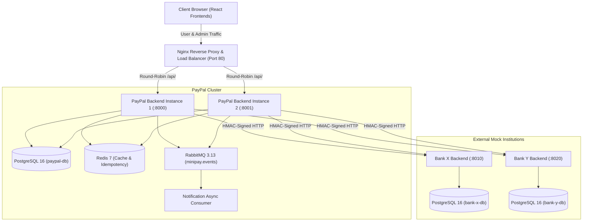
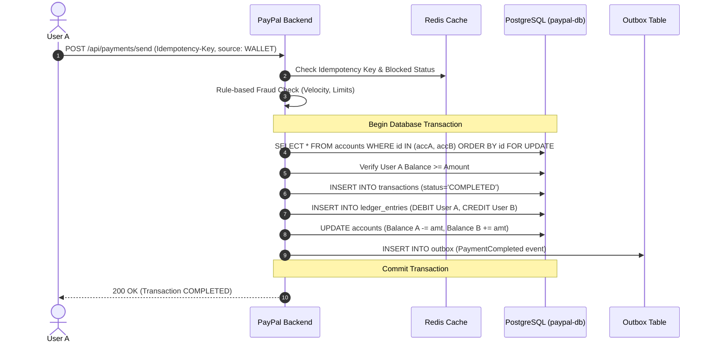
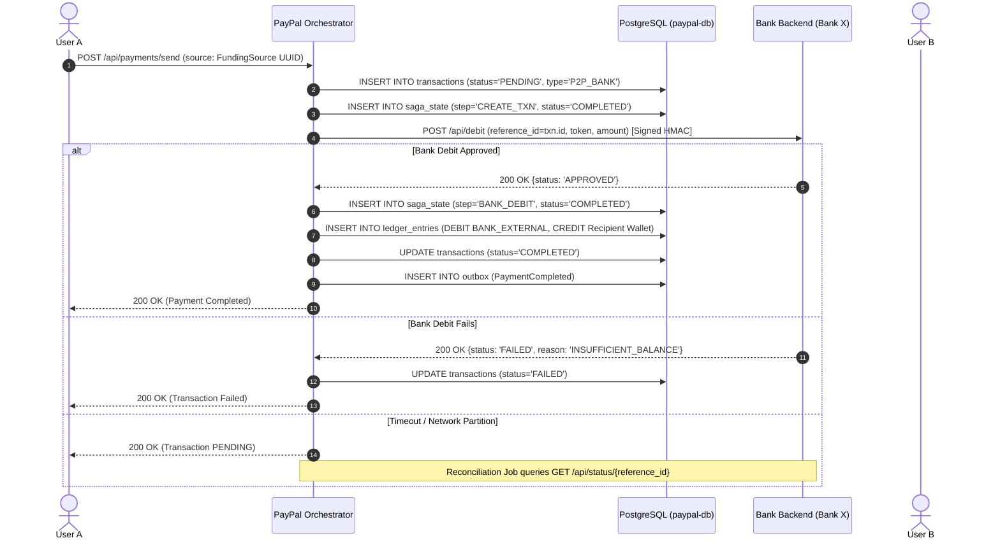
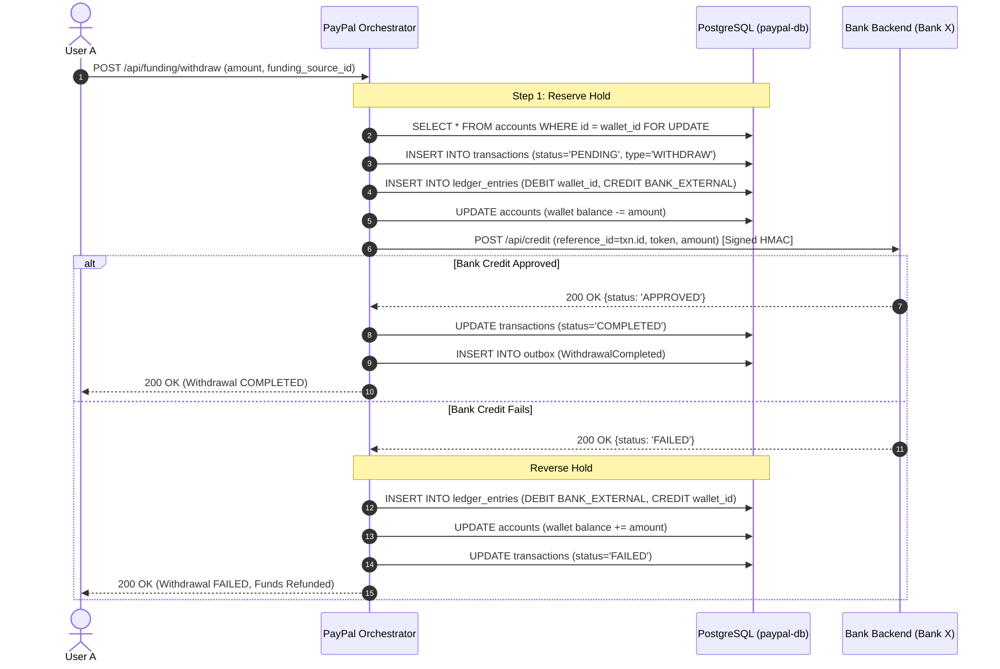
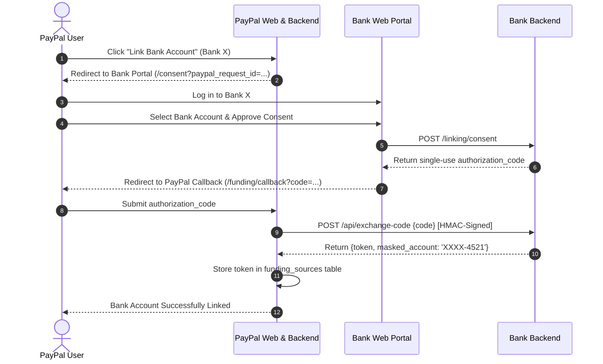
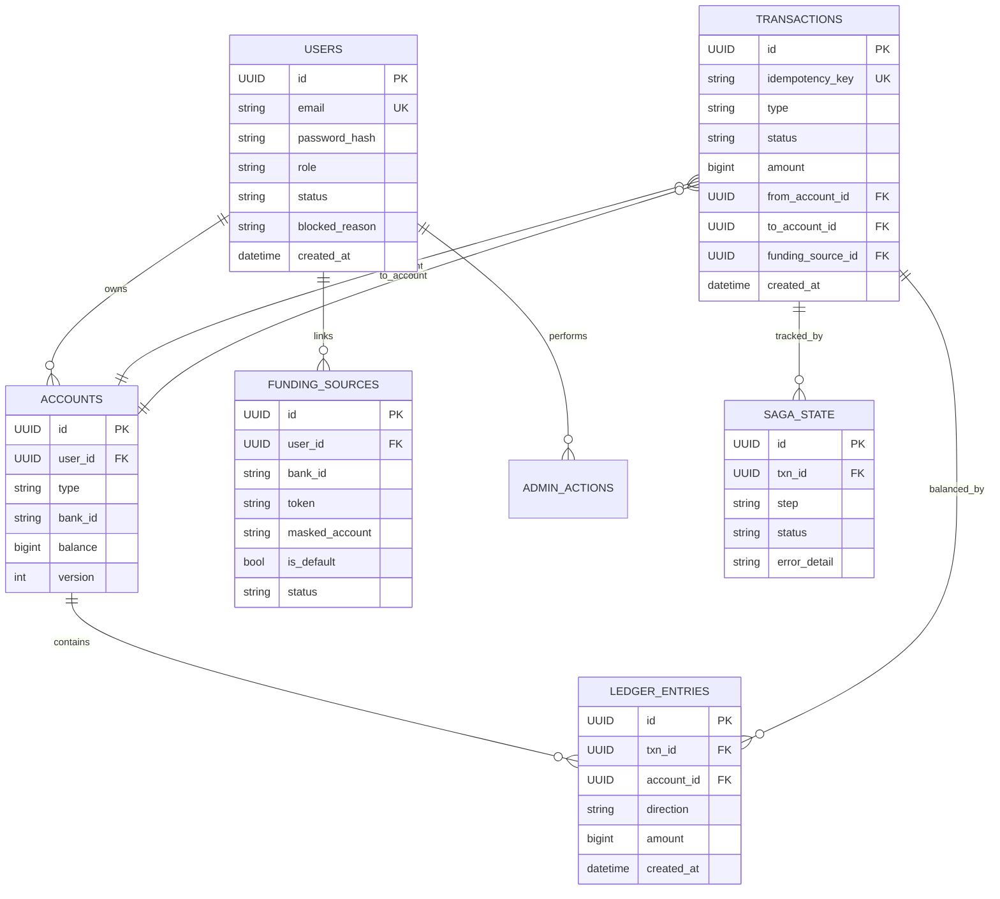

# MiniPay System Architecture

MiniPay is a distributed payment processing platform engineered to demonstrate core distributed systems concepts: **orchestrated sagas, idempotency, double-entry ledgers, deadlock-free concurrency control, fault tolerance, transaction outbox, and event-driven notifications**.

---

## 1. System Topology & Infrastructure

---

## 2. Sequence Diagrams

### 2.1 Wallet-to-Wallet P2P Transfer (Fixed-Order Row Locking)

---

### 2.2 Bank-Funded P2P Transfer (Orchestrated Saga with Compensation)

---

### 2.3 Withdraw to Bank (Reserve-First Pattern)

---

### 2.4 OAuth-Style Bank Linking Flow

---

## 3. Data Model (Entity-Relationship Diagram)

---

## 4. Distributed Systems Concepts Mapping

| Distributed Concept | Implementation Mechanism | Code Reference |
|---|---|---|
| **Sagas & Compensation** | Orchestrated multi-step sagas persisting step state; reverse holds and refund credits upon failure | `app/funding/service.py` |
| **Idempotency** | Header `Idempotency-Key` requirement + database UNIQUE constraints + deterministic retrieval | `app/middleware/idempotency.py`, `app/payment/service.py` |
| **Deadlock Prevention** | Total ordering / fixed-order row locking (`min(id1, id2)` locked first) with `SELECT ... FOR UPDATE` | `app/payment/service.py:100` |
| **Transactional Outbox** | Outbox table written in same DB transaction as state change; publisher pushes to RabbitMQ | `app/outbox/publisher.py` |
| **Fault Tolerance & Retries** | Tenacity exponential backoff retries on safe idempotent bank calls | `app/bank_client/client.py` |
| **Circuit Breakers** | PyBreaker fast-failure circuits per mock bank to prevent cascading exhaustion | `app/bank_client/client.py` |
| **Immediate Cache Invalidation** | Redis `blocked_users` set checked on every request across load-balanced instances | `app/auth/dependencies.py` |
| **Auditability & Double-Entry** | Append-only balanced ledger entries (`sum(debits) == sum(credits)`) | `app/wallet/service.py` |

